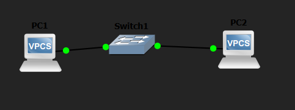

# Pruebas de conectividad

## Objetivo

En esta experiencia usamos una red en GNS3 para comparar dos criterios:

avisar ante el primer fallo de conectividad o esperar tres fallos

consecutivos.

Primero obtuvimos los registros. Después analizaremos qué alertas

se habrían generado con cada criterio.

## Red utilizada

Conectamos dos equipos VPCS a un Ethernet switch:

- PC1: 192.168.10.1/24.

- PC2: 192.168.10.2/24.

Usamos GNS3 2.2.61 en Windows y VPCS 0.6.2. Los pings se ejecutaron

desde PC1 hacia PC2.

La prueba comprueba conectividad ICMP entre los equipos. No evalúa

un servicio web.

## Procedimiento

Primero configuramos las IP y verificamos que hubiera respuesta.

Luego ejecutamos nueve pruebas con este comando:

    ping 192.168.10.2 -c 30 -i 1000 -w 500

En cada ejecución enviamos 30 solicitudes. Configuramos una espera

de 1000 ms entre envíos y de hasta 500 ms para recibir cada respuesta.

Las primeras tres pruebas se hicieron sin interrumpir la conexión.

En las restantes usamos Suspend y Resume sobre el enlace entre

Switch1 y PC2.

Para los cortes breves intentamos suspender y reanudar el enlace

rápidamente. En las dos últimas pruebas sostenidas buscamos mantener

el corte aproximadamente 10 segundos.

El primer intento de corte breve se extendió más de lo previsto.

Lo guardamos como sostenida-01.txt, pero lo consideramos una prueba

exploratoria y lo distinguimos de las posteriores.

## Resultados registrados

| Archivo | Respuestas | Timeouts |
|---------|------------|----------|
| normal-01.txt | 30 | 0 |
| normal-02.txt | 30 | 0 |
| normal-03.txt | 30 | 0 |
| breve-01.txt | 26 | 4 |
| breve-02.txt | 28 | 2 |
| breve-03.txt | 28 | 2 |
| sostenida-01.txt | 17 | 13 |
| sostenida-02.txt | 23 | 7 |
| sostenida-03.txt | 22 | 8 |

Las salidas completas están en resultados/. Las capturas de la

conectividad inicial y de la topología están en capturas/, en la

raíz del repositorio.

## Cómo reproducirlo

1. Importar GOYS-Observabilidad-Grupo07.gns3project en GNS3.

2. Iniciar los equipos.

3. Comprobar las direcciones con show ip en cada consola.

4. Ejecutar el comando de ping desde PC1.

5. Para introducir un corte, suspender el enlace Switch1–PC2

   y después reanudarlo.

6. Guardar todas las respuestas y los timeouts.

## Limitaciones y análisis pendiente

Los cortes se hicieron manualmente. No comenzaron siempre en el mismo

ping ni tuvieron una duración idéntica. Tampoco registramos sus tiempos

exactos, por lo que la cantidad de timeouts no equivale directamente

a segundos de caída.

No implementamos alertas automáticas. Aplicaremos ambos criterios

sobre los registros para comparar cuándo avisarían y cuántas

notificaciones producirían, contando una por incidente.

Una interrupción breve no se considera automáticamente una falsa

alarma. Para evaluar si requiere intervención debemos definir primero

el objetivo de servicio.

Las conclusiones se limitarán a lo observado en este laboratorio.

## Topología

