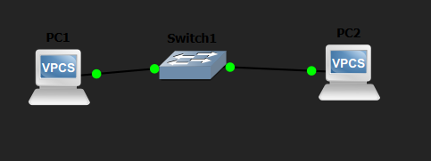

# Pruebas de conectividad

## Objetivo

Usamos una red en GNS3 para comparar dos criterios: avisar ante el primer fallo de conectividad o esperar tres fallos consecutivos.

Primero obtuvimos los registros y después aplicamos ambos criterios manualmente sobre las mismas pruebas. El análisis está en [analisis.md](analisis.md).

## Red utilizada

Conectamos dos equipos VPCS a un Ethernet switch:

- PC1: 192.168.10.1/24.
- PC2: 192.168.10.2/24.

Usamos GNS3 2.2.61 en Windows y VPCS 0.6.2. Los pings se ejecutaron desde PC1 hacia PC2.

La prueba comprueba conectividad ICMP entre los equipos. No evalúa el funcionamiento de un servicio web.

## Topología

Los cortes se realizaron sobre el enlace entre Switch1 y PC2.

## Procedimiento

Configuramos las direcciones IP y verificamos que hubiera respuesta. Después ejecutamos nueve pruebas con el siguiente comando desde PC1:

    ping 192.168.10.2 -c 30 -i 1000 -w 500

En cada ejecución enviamos 30 solicitudes. Configuramos una espera de 1000 ms entre envíos y de hasta 500 ms para recibir cada respuesta.

Las tres primeras pruebas se hicieron sin interrumpir la conexión. En las restantes usamos Suspend y Resume sobre el enlace Switch1–PC2.

Para los cortes breves intentamos suspender y reanudar el enlace rápidamente. En las dos últimas pruebas sostenidas buscamos mantener el corte aproximadamente 10 segundos, aunque no medimos su duración exacta.

El primer intento de corte breve se extendió más de lo previsto y produjo 13 fallos consecutivos. Lo guardamos como sostenida-01.txt. Después de ejecutar las pruebas decidimos presentarlo por separado como exploratorio. Conservamos el registro y mostramos también los totales al incluirlo.

## Criterios comparados

- C1: avisar ante el primer fallo de una racha.
- C2: avisar ante el tercer fallo consecutivo de una racha.

Elegimos tres fallos como valor ilustrativo. No buscamos demostrar que sea el mejor umbral.

Consideramos un incidente a una racha de fallos consecutivos. La primera respuesta exitosa termina esa racha.

Cada criterio cuenta una sola notificación de apertura por incidente si alcanza su condición. Los fallos posteriores de la misma racha no agregan avisos. La recuperación tampoco se cuenta como una notificación.

No implementamos un sistema de alertas automáticas: identificamos manualmente en los registros cuándo habría avisado cada criterio.

## Resultados registrados

| Archivo | Respuestas | Timeouts |
|---------|------------|----------|
| normal-01.txt | 30 | 0 |
| normal-02.txt | 30 | 0 |
| normal-03.txt | 30 | 0 |
| breve-01.txt | 26 | 4 |
| breve-02.txt | 28 | 2 |
| breve-03.txt | 28 | 2 |
| sostenida-01.txt — exploratoria | 17 | 13 |
| sostenida-02.txt | 23 | 7 |
| sostenida-03.txt | 22 | 8 |

Las salidas originales están en [resultados/](resultados/). Las capturas están en [capturas/](../capturas/).

La comparación principal incluye ocho pruebas: tres normales, tres de corte breve y dos de corte sostenido. Son 240 comprobaciones.

En esas ocho pruebas, C1 habría generado cinco notificaciones y C2 tres. La diferencia aparece en los dos cortes breves de dos fallos: C1 avisa y C2 no alcanza su umbral.

En las rachas detectadas por ambos criterios, C2 avisa dos comprobaciones después que C1. Si incluimos la prueba exploratoria, los totales son seis notificaciones para C1 y cuatro para C2.

## Cómo reproducirlo

1. Importar GOYS-Observabilidad-Grupo07.gns3project en GNS3.
2. Iniciar los equipos.
3. Ejecutar show ip en cada consola y comprobar las direcciones indicadas.
4. Desde PC1, comprobar la conexión con:

       ping 192.168.10.2 -c 5

5. Ejecutar el comando de 30 solicitudes indicado en el procedimiento.
6. Para realizar una prueba normal, dejar el enlace activo.
7. Para introducir un corte, hacer clic derecho sobre el enlace Switch1–PC2 y seleccionar Suspend. Después seleccionar Resume para recuperar la conexión.
8. Guardar la salida completa, incluyendo las respuestas y los timeouts.
9. Aplicar C1 y C2 sobre el mismo registro, identificando las rachas y la primera respuesta posterior a cada corte.

Los cortes manuales pueden producir cantidades de fallos distintas de las nuestras. Reproducir el procedimiento no garantiza obtener exactamente los mismos valores.

Guardar las nuevas ejecuciones con nombres diferentes para conservar los registros originales.

## Verificación del proyecto importado

Importamos el proyecto en una copia de prueba, comprobamos las direcciones y verificamos la comunicación entre PC1 y PC2.

También realizamos un ensayo de corte y recuperación. El registro está en [ensayo-corte-recuperacion.txt](verificacion/ensayo-corte-recuperacion.txt) y la captura de la prueba sin Internet está en [03-prueba-sin-internet.png](../capturas/03-prueba-sin-internet.png).

Estas evidencias corresponden a la verificación de la demo y no se suman a las nueve ejecuciones originales.

## Relación con el estado del arte

La experiencia muestra cómo cambia la decisión de avisar cuando modificamos el criterio de activación. Esperar varios fallos evita algunos avisos por cortes breves, pero retrasa la detección y puede dejar interrupciones sin avisar.

Los trabajos revisados estudian problemas más amplios. COLA y la propuesta de Zha y sus colaboradores agrupan alertas relacionadas. AlertGuardian filtra y resume alertas y propone mejoras en las reglas. La revisión de Ndichu y sus colaboradores analiza el uso de IA para gestionar alertas de seguridad y reducir la fatiga de los analistas.

También revisamos Keep y PagerDuty AIOps como ejemplos de productos con funciones de gestión y agrupación de alertas. No los instalamos ni evaluamos sus resultados.

La relación es conceptual: nuestra práctica compara cuándo activar un aviso; la bibliografía también estudia cómo relacionar y gestionar alertas de distintas fuentes. Los timeouts del laboratorio no son, por sí solos, una tormenta de alertas.

El desarrollo y las fuentes están en [estado-del-arte.md](../documento/estado-del-arte.md) y [referencias.md](../documento/referencias.md).

## Limitaciones

- Los cortes fueron manuales y no comenzaron ni terminaron siempre en la misma comprobación.
- Los registros no incluyen marcas temporales. Expresamos la demora en comprobaciones, no en segundos.
- La cantidad de timeouts no equivale directamente a la duración del corte.
- Las pruebas evalúan conectividad ICMP, no el funcionamiento completo de una aplicación.
- No implementamos alertas automáticas, agrupación inteligente ni IA.
- No definimos antes de medir qué interrupciones requerían intervención. El análisis presenta interpretaciones alternativas y explicita sus supuestos.
- Una interrupción breve no se considera automáticamente una falsa alarma.
- Son pocas pruebas, con una sola racha por ejecución con corte. No evaluamos fallas intermitentes.
- Las conclusiones se limitan a este laboratorio y no se generalizan a redes reales.